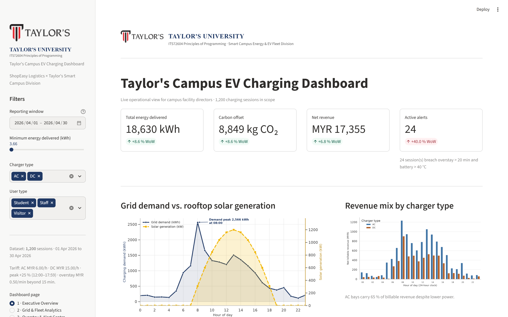

# Taylor's Campus EV Charging Dashboard

**Module:** ITS72604 Principles of Programming — Final Examination (September 2026)
**Student:** LIU ZENGJIE (0399396)
**Module Learning Outcome:** MLO3

A four-page Streamlit dashboard for the ShopEasy Logistics × Taylor's Smart Campus
EV charging fleet. It monitors grid demand, battery state of charge, carbon
reduction and charging-session revenue, and turns the same table into an
executive view, an analytics view, a live alert centre and a data-export page.



---

## Quick start

```bash
pip install -r requirements.txt
python data_pipeline.py        # builds assets/cleaned_energy_sales_data.csv
streamlit run app.py           # http://localhost:8501
```

On Windows, double-click **`run_app.bat`** instead.

## Pages

| Page | What it answers |
|---|---|
| **1 · Executive Overview** | Four KPI cards with week-over-week deltas (energy, CO₂, revenue, active alerts), the hour-by-hour demand curve against rooftop solar, and the revenue mix by charger type. |
| **2 · Grid & Fleet Analytics** | The three required panels — demand vs solar, cost distribution by user type, pack temperature vs energy delivered with trend lines — plus the correlation heatmap. |
| **3 · Overstay & Alert Centre** | Facility-manager thresholds for battery temperature and overstay; sessions are re-scored on the fly and surfaced as `st.error` / `st.warning` / `st.success` banners with a downloadable alert list. |
| **4 · Data Explorer & Export** | Column picker, filtered grid, descriptive statistics and a CSV download of exactly the filtered rows. |

Every page is driven by the same sidebar filters (reporting window, minimum
energy, charger type, user type), so all figures stay consistent. The selected
page is mirrored in the URL (`?page=alerts`) and can be shared.

## Repository layout

```
app.py                          Streamlit application (4 pages)
data_pipeline.py                ETL: cleanse -> feature engineer -> export
visualisations.py               Reusable Matplotlib/Seaborn chart builders
visualisation_panels.py         Renders the three report panels
section_a_q1_numpy_pandas.py    Section A Q1: NumPy vs pandas demonstrations
section_a_q2_functional_pipeline.py  Section A Q2: filter / map / reduce
section_a_q3_visual_charts.py   Section A Q3: Matplotlib vs Seaborn comparison
capture_screenshots.py          Headless capture of the dashboard pages
requirements.txt                Runtime dependencies
DEPLOY_STREAMLIT_CLOUD.md       How to publish the app
assets/                         Datasets, Taylor's logo and figures
.streamlit/config.toml          Theme and server settings
run_app.bat                     One-click Windows launcher
```

## Data dictionary (engineered table)

| Column | Type | Description |
|---|---|---|
| `Session_ID` | text | Unique charging session key |
| `Session_Date` | date | Reporting date (30-day operating window) |
| `Start_Hour` | int | Session start hour, 0–23 |
| `Charger_Type` | text | `AC` (7.4 kW class) or `DC` (50 kW class) |
| `User_Type` | text | `Student`, `Staff` or `Visitor` |
| `Duration_Mins` / `Duration_Hours` | float | Connection time and its hour equivalent |
| `Energy_kWh` | float | Energy delivered (median-imputed where missing) |
| `Power_Rate_kW` | float | `Energy_kWh / Duration_Hours` |
| `Overstay_Mins` | int | Minutes connected after the session completed |
| `Battery_Temp_C` | float | Pack temperature at the end of the session |
| `Ambient_Temp_C` | float | Modelled bay ambient temperature (diurnal profile) |
| `Carbon_Savings_kgCO2` | float | `Energy_kWh × 0.475` |
| `Base_Fee_MYR` | float | `Base_Rate_MYR × Duration_Hours` |
| `Peak_Surge_MYR` | float | 25 % of base fee for 12:00–17:59 starts |
| `Overstay_Fee_MYR` | float | MYR 0.50 per minute beyond a 15-minute grace |
| `Net_Billable_MYR` | float | Base + peak surge + overstay fee |
| `Risk_Alert` | 0/1 | Overstay > 20 min **and** battery > 40 °C |

## Modelling assumptions

1. **Tariff card** — AC MYR 6.00/hour, DC MYR 15.00/hour; peak surcharge +25 %
   for sessions starting 12:00–17:59; overstay MYR 0.50/minute after a
   15-minute grace period.
2. **Carbon factor** — 0.475 kg CO₂ avoided per kWh of grid energy displaced.
3. **Ambient temperature** — the extract logs pack temperature only, so an
   ambient series is reconstructed from a Subang Jaya diurnal profile
   (25 °C night floor, 31 °C afternoon peak).
4. **Solar generation** — a half-sine irradiance curve for a 1,200 kWp rooftop
   array between 07:00 and 19:00.
5. **Reporting calendar** — the anonymised extract carries no timestamps; the
   1,200 sessions are mapped onto a deterministic 30-day window (40 sessions per
   day from 1 April 2026) so that the date filter is meaningful.

## Headline results (1,200 sessions)

| Metric | Value |
|---|---|
| Energy delivered | 18,630.09 kWh |
| Carbon avoided | 8,849.28 kg CO₂ |
| Net billable revenue | MYR 17,355.00 |
| High-risk sessions | 24 (5 critical) |
| Peak demand | 2,566 kWh at 08:00 |
| AC share of revenue | 65.2 % |

## Deployment

See [DEPLOY_STREAMLIT_CLOUD.md](DEPLOY_STREAMLIT_CLOUD.md) for the five-step
Streamlit Community Cloud deployment.
